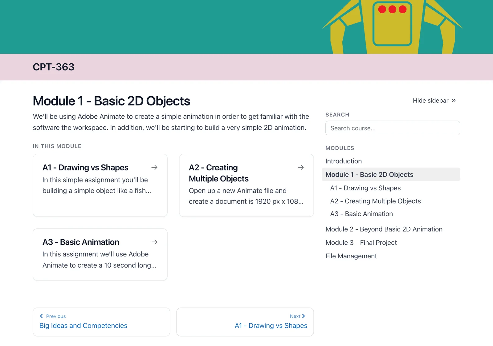

# From Your LMS

Already have a course in your LMS? Start from it, with a free converter (in beta) – no Grav installation needed to see what carries over:

- **[Common Cartridge Converter](https://common-cartridge-converter.hibbittsdesign.org/)** – export a course from Canvas, Moodle, Brightspace or Blackboard, and download its modules, ready for Open Course Hub

Table: What carries over from an LMS course

| Content | In the converted course |
|---|---|
| Modules, in order | Carried over, each module with its own pages |
| Pages – text, headings, images and tables | Carried over |
| Text headers inside a module | Carried over, grouping the pages under them |
| Assignment instructions | Carried over as pages – submissions and grading stay in your LMS |
| Files, such as PDFs and slides | Carried over, linked from their module |
| Web links and YouTube videos | Carried over – YouTube videos embedded |
| Vimeo videos, Google Slides and H5P activities | Links to the original, ready to embed |
| Quizzes and discussions | Left out – they stay in your LMS, and the conversion report lists them |
| LTI tools | A note on the module page, pointing to the original course |

*A module from an LMS course in Open Course Hub, converted with no revisions – from Digital Animation (D. Ingram), CC BY-NC*

Example (a raw conversion, with no revisions or fine-tuning): [LMS course content in Open Course Hub](https://demo.hibbittsdesign.org/grav-open-course-hub-common-cartridge-it2dda/)

