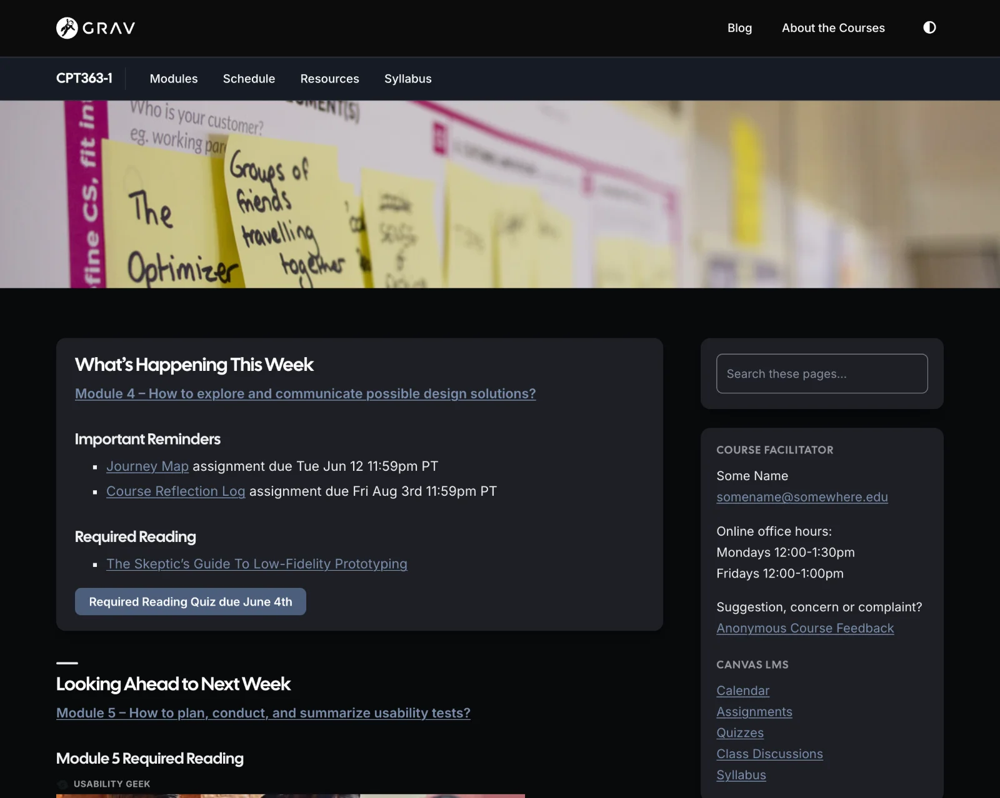

# Accessibility and Privacy

Built in, for different kinds of learners:

- **For keyboard users:** a "Skip to content" link, arrow-key Previous/Next on module pages, **/** to jump to the search box, and wide tables you can reach with Tab
- **For screen reader users:** one page title per page (kept even when hidden), labelled page regions and links, and titled embeds – module pages also announce the current section and open or closed accordions
- **For everyone:** comfortable line lengths, a module list you can hide to focus on the page, light and dark modes, and clean printed pages
- **For privacy:** content stays on a site you control, with no third-party tracking built in (embeds such as YouTube videos bring their own); Grav's own page view counts stay on the site, and Keep My Place remembers a learner's place in their own browser only

*Open Course Space in dark mode*

Accessibility also depends on the content itself – headings, alt text and link text are up to the author (see [Improving the Accessibility of Your Markdown](https://www.smashingmagazine.com/2021/09/improving-accessibility-of-markdown/?target=_blank)).
