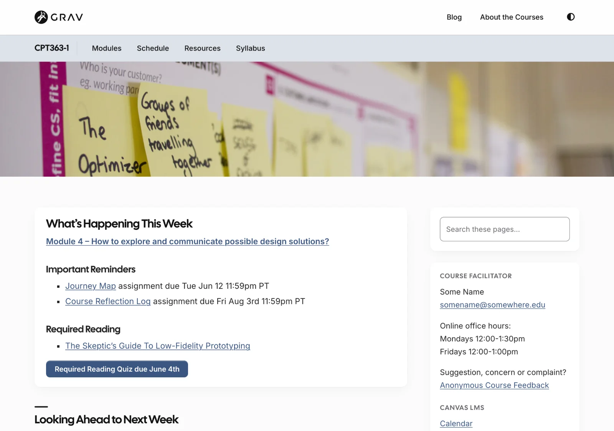

# Open Course Space

Its twin, for **courses**: a free, open-source course site organized by modules – one course or many, in a single site.

- A module list beside every module page, with Previous and Next
- Home page reminders that link to this week's and next week's modules
- Each course with its own menu, colour and header image, and a blog shared by all your courses

Pages **embed in Canvas, Moodle or Brightspace** – just add `?embedded=true` (this works for Open Publishing Space pages too).

**New:** Open Course Space is an early release – the free successor to Open Course Hub and Open MultiCourse Hub, which are still available, including for Grav 1.7.

*A course home page, from the Open Course Space demo*

Already have a course in your LMS? Start from it, with a free converter (in beta) – no Grav installation needed to see what carries over:

- **[Common Cartridge Converter](https://common-cartridge-converter.hibbittsdesign.org/?target=_blank)** – export a course from Canvas, Moodle, Brightspace or Blackboard, and download its modules, ready for Open Course Space or Open Course Hub

Example (a raw conversion, with no revisions or fine-tuning): [LMS course content in Open Course Space](https://demo.hibbittsdesign.org/variants/grav-open-course-space-common-cartridge-it2dda/?target=_blank)

[hideifembedded]
See the demo: [Open Course Space](https://demo.hibbittsdesign.org/grav-open-course-space/?target=_blank) · [a module, embedded](https://demo.hibbittsdesign.org/grav-open-course-space/cpt363-basic/modules/module-04?embedded=true&target=_blank)

Try the Admin 2 panel with a course site: [read-only demo](https://try.hibbittsdesign.org/grav-skeleton-course-hub/admin?target=_blank) (the sign-in details are on its sign-in screen).
[/hideifembedded]

For more, see the [Open Courses](/open-course-hub) guide.
