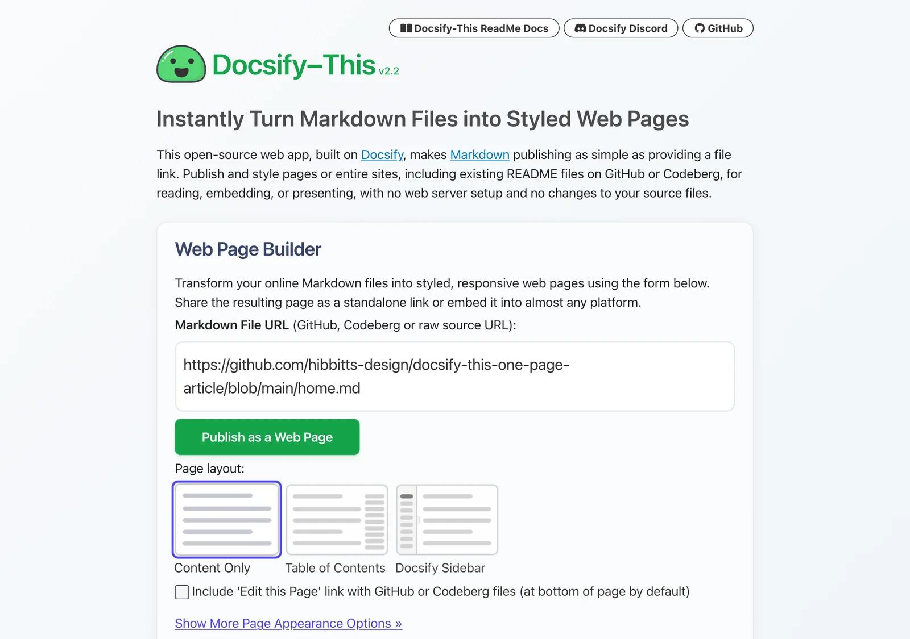

# Docsify-This

A free, open-source web app that turns online Markdown files into styled, responsive web pages – no signup, no install. Named a finalist in the Open Infrastructure category of the 2024 Open Education Awards for Excellence.

- **Instant pages:** paste the address of a Markdown file on GitHub, Codeberg or anywhere public, and it's a web page in seconds
- **One page or a whole site:** several files become a multi-page site, with a sidebar, Previous/Next and search
- **Point-and-click styling:** the Web Page Builder sets fonts, colours and layout – and the choices travel in the page's address, so sharing the link shares the look
- **Embeds almost anywhere:** Canvas, Moodle, Brightspace, WordPress and more
- **Rich content:** H5P activities, LaTeX math and Mermaid diagrams
- **Edit in place:** change the Markdown file, and the page updates shortly after

*The Docsify-This Web Page Builder: paste a Markdown file's address, choose a layout and publish*

**Start from a template:** a [Guide Site](https://github.com/hibbitts-design/docsify-this-guide-site?target=_blank) for an open guide, or a [Course Site](https://github.com/hibbitts-design/docsify-this-multiple-page-course-site?target=_blank) for a course – copy it to your GitHub account and edit the Markdown. When you want your own address and styling, the same files move to a Docsify Starter Kit (Part 3).

[hideifembedded]
[Try Docsify-This](https://docsify-this.net/?target=_blank) · [A course on Docsify-This](https://docsify-this.net/?basePath=https://raw.githubusercontent.com/paulhibbitts/docsify-this-open-course-hub-site/main&homepage=home.md&sidebar=true&loadSidebar=_sidebar.md&loadNavbar=_navbar.md&loadFooter=_footer.md&pagination=true&searchbox=true&name=CPT-363) · [The Read, Move, Reuse guides on Docsify-This](https://docsify-this.net/?basePath=https://raw.githubusercontent.com/paulhibbitts/docsify-this-read-move-reuse-site/main&homepage=home.md&name=Read%2C%20Move%2C%20Reuse&sidebar=true&loadSidebar=_sidebar.md&loadNavbar=_navbar.md&pagination=true&searchbox=true&dark-mode=auto&loadFavicon=favicon.png)
[/hideifembedded]
