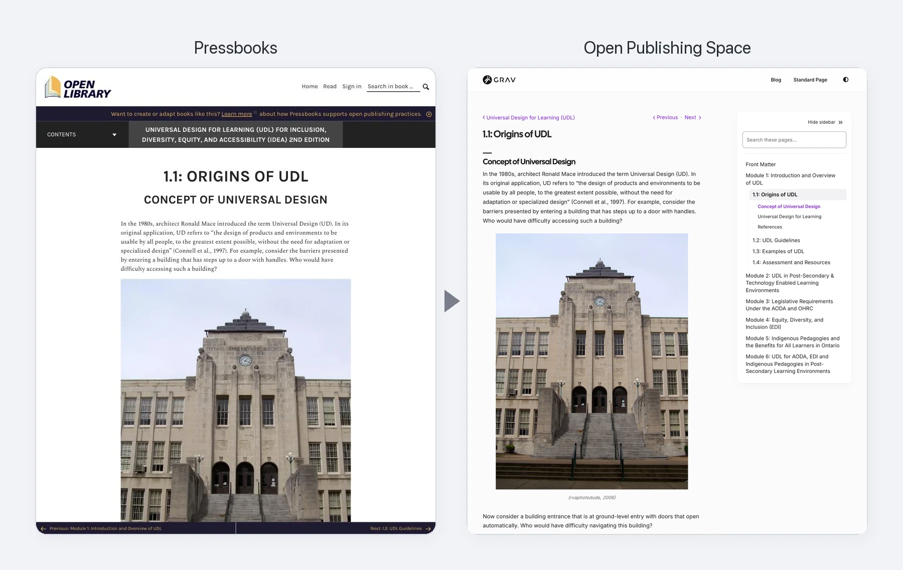
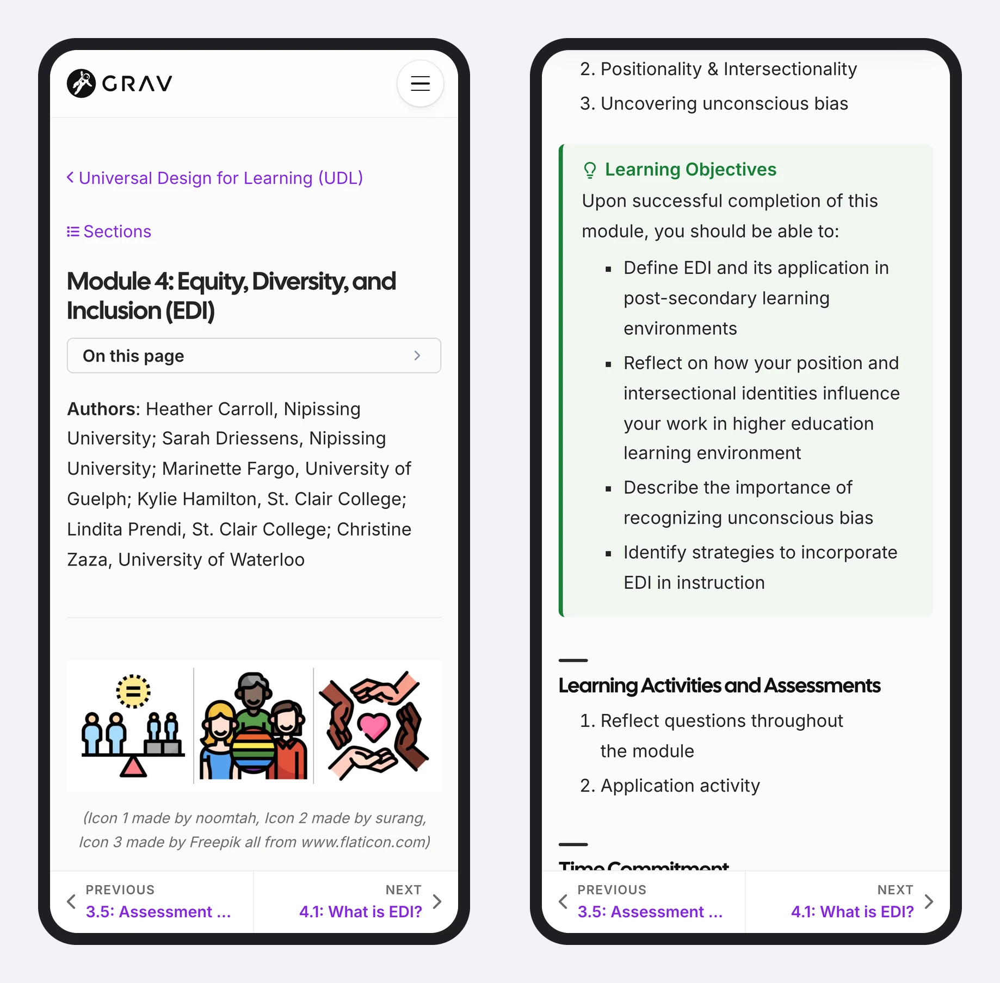

Start from what you already have, with two free converters (both in beta)[^1] – no Grav installation needed to see what carries over:

- **[Pressbooks Converter](https://pressbooks-converter.hibbittsdesign.org/)** – upload a [term]Pressbooks[/term] export, and download an Open Publishing Space guide, ready to review and publish
- **[Common Cartridge Converter](https://common-cartridge-converter.hibbittsdesign.org/)** – export a course from Canvas, Moodle, Brightspace or Blackboard as a [term]Common Cartridge[/term] file, and download its modules, ready for Open Course Space or Open Course Hub

Table: What carries over from a Pressbooks book

| Content | In the converted guide |
|---|---|
| Text, headings, figures and captions | Carried over |
| Exercises and other callouts | Carried over as callout boxes |
| Footnotes | Carried over |
| H5P activities and videos | Links back to the book, ready to embed |
| Tables inserted with a Pressbooks shortcode | Shown as text, to replace with a Markdown table |

*The same chapter in Pressbooks and in Open Publishing Space, with no revisions – from [Universal Design for Learning (UDL) for Inclusion, Diversity, Equity, and Accessibility (IDEA)](https://ecampusontario.pressbooks.pub/universaldesign2/), [term]CC BY 4.0[/term]*

*A module's intro page on a phone: its text and images, then its Learning Outcomes as a Learning Objectives box*

Examples (raw conversions, with no revisions or fine-tuning): [an openly licensed Pressbooks book in Open Publishing Space](https://demo.hibbittsdesign.org/grav-open-publishing-quark2-pressbooks-udl/) · [LMS course content in Open Course Hub](https://demo.hibbittsdesign.org/grav-open-course-hub-common-cartridge-it2dda/)

[^1]: Beta means they handle many books and courses well, but a converted guide or course may need some tidying – tables inserted with a Pressbooks shortcode, for example, need replacing with Markdown tables.
