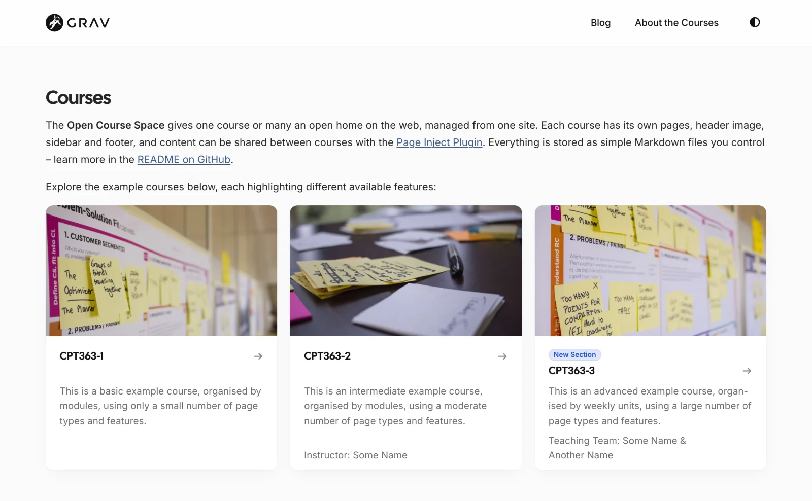
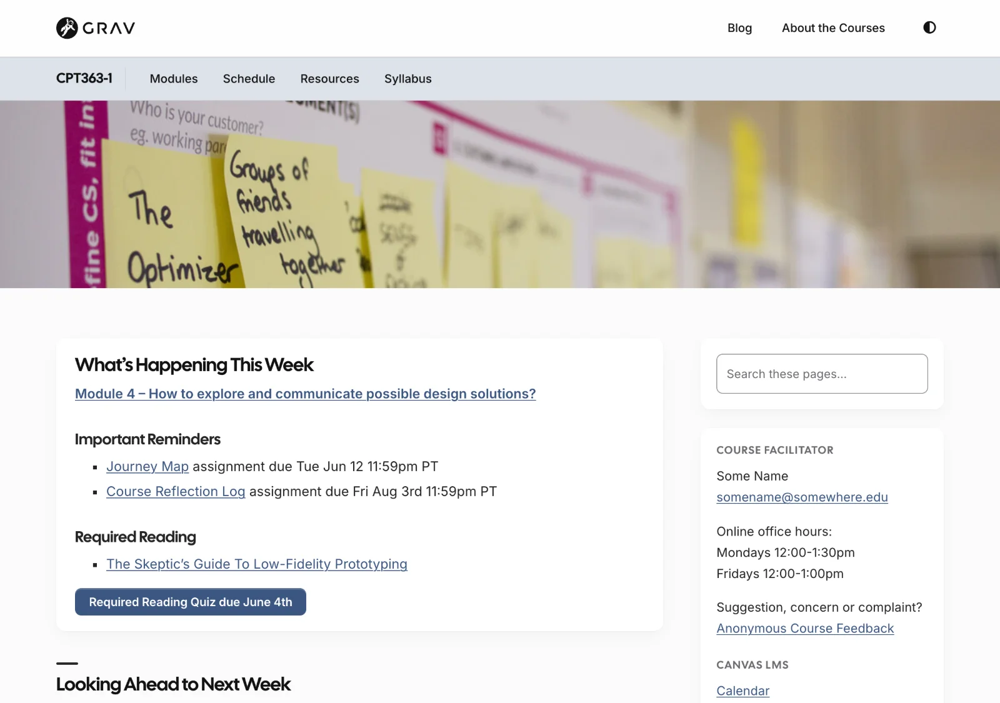
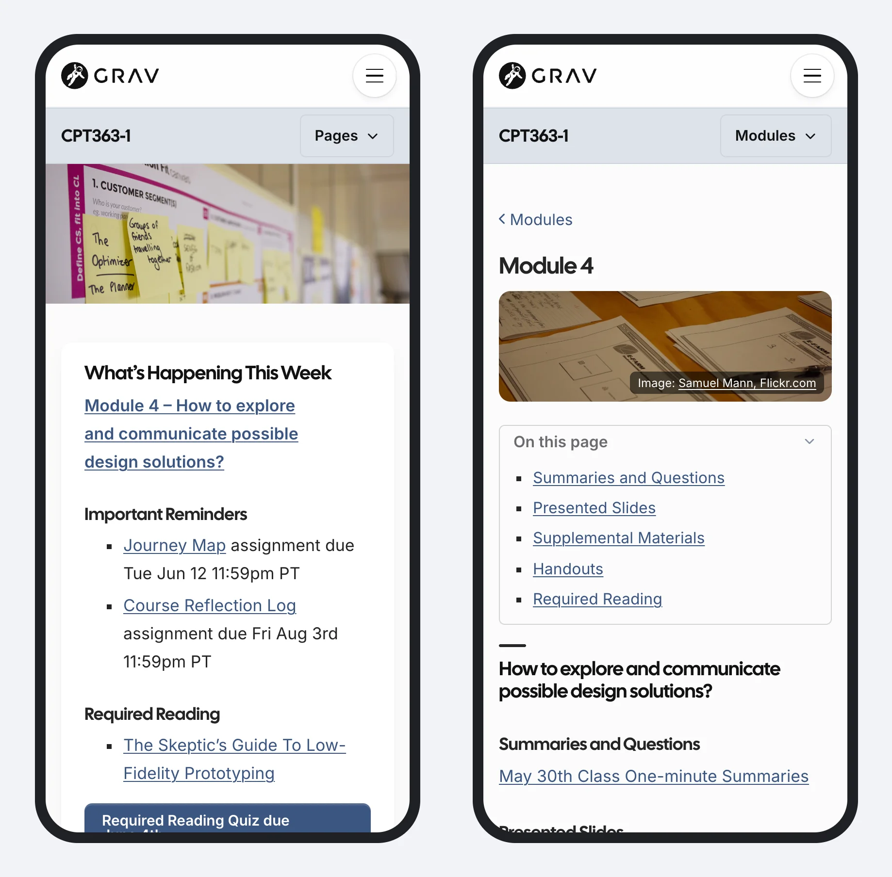

A free, open-source website starter for **open courses**, organized by modules and built on the Grav 2 CMS – one course or many, in a single site.

- A Courses page with a card for each course, and each course with its own menu, colour and header image
- A module list beside every module page, with Previous and Next
- Home page reminders that link to this week's and next week's modules
- On phones, a module's sections in an "On this page" box
- A blog shared by all your courses

Pages **embed in Canvas, Moodle or Brightspace** – just add `?embedded=true` to a page's address.

[showifembedded]
> [!TIP]
> You're reading this page embedded – the same way it would appear inside Canvas, Moodle or Brightspace.
[/showifembedded]

Editing works **in the browser** with Grav's Admin 2 panel, or as Markdown files with any editor or **via Git** – with no database needed, on most PHP web hosts.

**New:** Open Course Space is an early release, on the same theme as Open Publishing Space – the free successor to Open Course Hub and Open MultiCourse Hub.

*The Courses page, from the Open Course Space demo*

*A course home page, from the Open Course Space demo*

*The Open Course Space demo on a phone: this week's module on the home page, and a module's sections in an "On this page" box*

[hideifembedded]
[See the demo](https://demo.hibbittsdesign.org/grav-open-course-space/) · [A module, embedded](https://demo.hibbittsdesign.org/grav-open-course-space/cpt363-basic/modules/module-04?embedded=true) · [This page, embedded](/open-course-hub/open-course-hub?embedded=true)

Try the Admin 2 panel with a course site: [read-only demo](https://try.hibbittsdesign.org/grav-skeleton-course-hub/admin) (the sign-in details are on its sign-in screen).
[/hideifembedded]
