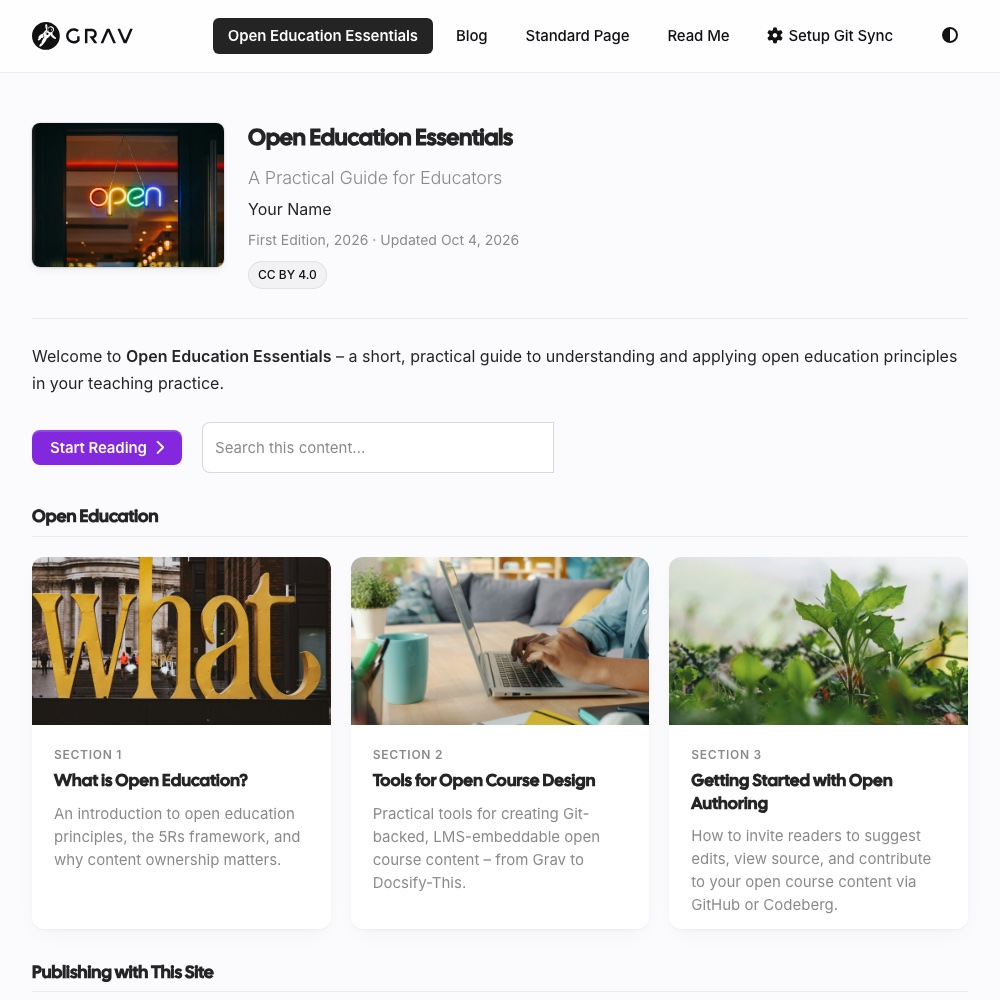

A free, open-source website starter for sharing **web-first open textbooks and guides**, alongside a blog and other pages. Like every Grav **starter skeleton**, it comes as Grav 2, a theme and sample content, ready to upload.

- Guides with section cards, reading progress, Learning Objectives, OER attribution, search and **Keep My Place** (pick up where you left off)
- One site can hold several guides, each with a card on a Guides page
- Pages you can read, present like slides, embed in an LMS, print or get as Markdown

*A guide home page, from the Open Publishing Space demo*

Already have a book in Pressbooks? Start from it, with a free converter (in beta) – no Grav installation needed to see what carries over:

- **[Pressbooks Converter](https://pressbooks-converter.hibbittsdesign.org/?target=_blank)** – upload a Pressbooks export, and download an Open Publishing Space guide, ready to review and publish

Example (a raw conversion, with no revisions or fine-tuning): [the original book in Pressbooks](https://ecampusontario.pressbooks.pub/universaldesign2/?target=_blank) · [the same book in Open Publishing Space](https://demo.hibbittsdesign.org/grav-open-publishing-quark2-pressbooks-udl/?target=_blank)

[hideifembedded]
See the demo: [one guide](https://demo.hibbittsdesign.org/grav-open-publishing-quark2/?target=_blank) · [several guides](https://demo.hibbittsdesign.org/grav-open-publishing-quark2-guides/?target=_blank)

Try the Admin 2 panel: [read-only demo](https://try.hibbittsdesign.org/grav-skeleton-open-publishing-space/admin?target=_blank) (the sign-in details are on its sign-in screen).
[/hideifembedded]

For more, see the [Open Textbooks and Guides](/open-publishing-space) guide.
