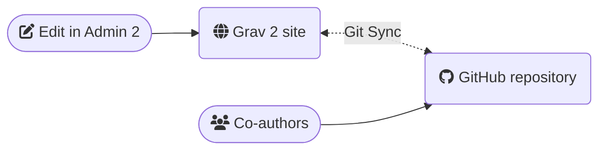
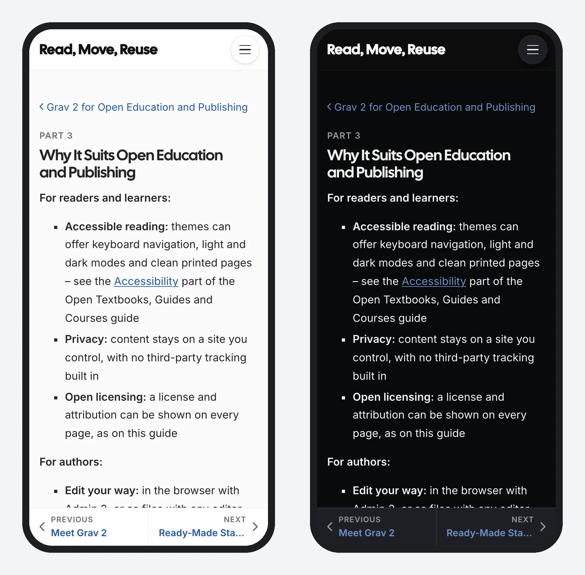

**For readers and learners:**

- **Read anywhere:** the same pages work on phones, embed in an LMS and print cleanly – nothing to export
- **Accessibility built in:** the free starters include keyboard navigation, labelled page regions for screen readers, and light and dark modes – more in [Accessibility and Privacy](/guide/modules/accessibility)
- **Privacy:** no third-party tracking built in, on a site you control
- **Clear licensing:** a licence and attribution on every page, as on this guide

**For authors:**

- **Edit your way:** in the browser with Admin 2, or as files in any editor – or both
- **Co-authors welcome:** invite them to Admin 2, each with their own account and only the access you give them
- **Plain Markdown that moves:** pages go between Grav sites, [Docsify-This](https://docsify-this.net/?target=_blank) (which shows Markdown as web pages), GitHub and other tools with little rework
- **Reuse built in:** you – and, with an open licence, anyone – can get any page's Markdown to adapt and share

Optional: with the free [Git Sync](https://github.com/trilbymedia/grav-plugin-git-sync?target=_blank) plugin, every change is saved to a GitHub repository with its full history, and co-authors can suggest edits there.

**See an example:** the Open Publishing Space version of this site keeps its pages in a [public GitHub repository](https://github.com/paulhibbitts/share-move-reuse/tree/main/quark2/pages?target=_blank), just as Git Sync would keep them – see [this page's own file](https://github.com/paulhibbitts/share-move-reuse/blob/main/quark2/pages/05.grav-2/03.why-it-suits-open-education/section.md?target=_blank), or [every edit to it](https://github.com/paulhibbitts/share-move-reuse/commits/main/quark2/pages/05.grav-2/03.why-it-suits-open-education/section.md?target=_blank).

**For whoever runs the site:**

- **Simple hosting:** a standard PHP web host is enough – no database and no build tools
- **Easy backups and moves:** the whole site is one folder – copy it to back up, or to move to another host
- **Fewer moving parts:** pages are files rather than database entries, so there's less to keep updated

**How it compares** with other popular tools for open textbooks, guides and courses – WordPress-based book tools such as Pressbooks, and static site tools such as Quarto, Jupyter Book, Jekyll and Hugo:

| | Grav 2 | WordPress-based (such as Pressbooks) | Static site tools |
|---|---|---|---|
| Content stored as | Markdown files | A database | Markdown files |
| Editing | In the browser (Admin 2), or any editor | In the browser | Edit files (or add a separate editing tool); a build publishes them |
| Hosting | A PHP web host (PHP 8.3 or newer) | A hosted service, or your own WordPress | Free static hosting, such as GitHub Pages |
| Markdown of every page | Built in | Not built in | The source files themselves |
| EPUB and formatted PDF | No – pages print cleanly | Yes – a real strength | Yes, especially Quarto |
| Running code in pages (notebooks) | No | No | Yes, with Quarto and Jupyter Book |
| Books and courses from the same content | Yes – the same Markdown moves between the book and course starters | Books | Possible, with setup |

Pick Grav 2 for plain Markdown files with no build step, editable in the browser by co-authors who don't use Git; a WordPress-based book tool such as Pressbooks if you need EPUB or print-ready PDF; or a static site tool if you're comfortable with Git and want free hosting.

*This page on a phone, in light and dark mode*

[hideifembedded]
Try it on this site: press → for the next page, **/** to search, switch to dark mode (top right), or open print preview.

**See it moved:** this site's [Open Textbooks, Guides and Courses](/guide) guide also runs, with the same content, as an Open Publishing Space guide on the [Quark 2](https://share-move-reuse.hibbittsdesign.org/guide?target=_blank) and [classic Quark](https://demo.hibbittsdesign.org/share-move-reuse/share-move-reuse-ops-quark/guide?target=_blank) themes, as an [Open Course Space course](https://demo.hibbittsdesign.org/share-move-reuse/share-move-reuse-ocs/guide?target=_blank), and on Grav Premium Helios as an [open reader](https://demo.hibbittsdesign.org/share-move-reuse/share-move-reuse-hor/guide?target=_blank) and a [course hub](https://demo.hibbittsdesign.org/share-move-reuse/share-move-reuse-hch/guide?target=_blank) – and as plain Markdown pages on [Docsify-This](https://docsify-this.net/?basePath=https://raw.githubusercontent.com/paulhibbitts/docsify-this-share-move-reuse-site/main&homepage=home.md&name=Share%2C%20Move%2C%20Reuse&sidebar=true&loadSidebar=_sidebar.md&loadNavbar=_navbar.md&pagination=true&searchbox=true&dark-mode=auto&loadFavicon=favicon.png&zoom-images=true&target=_blank).
[/hideifembedded]

> [!TIP]
> **A domain of one's own:** because a Grav 2 site is just a folder of files, it's a good fit for personal or institutional web hosting – your content isn't tied to a single platform or host.
