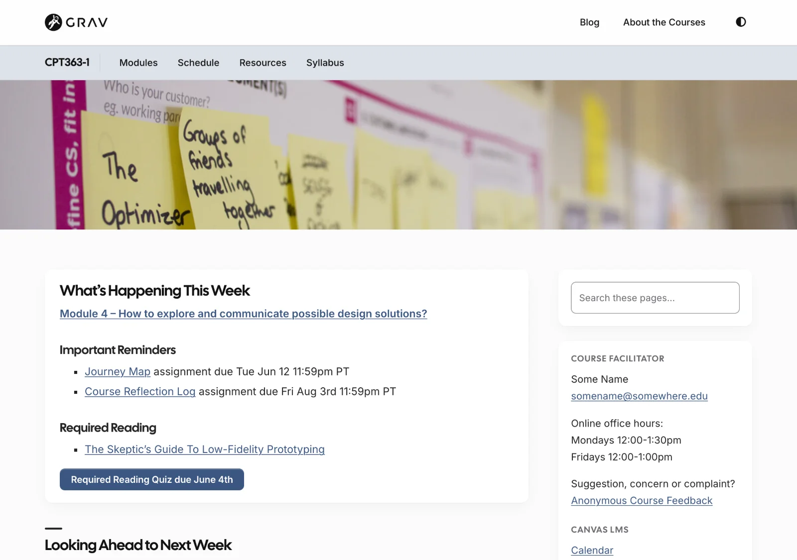
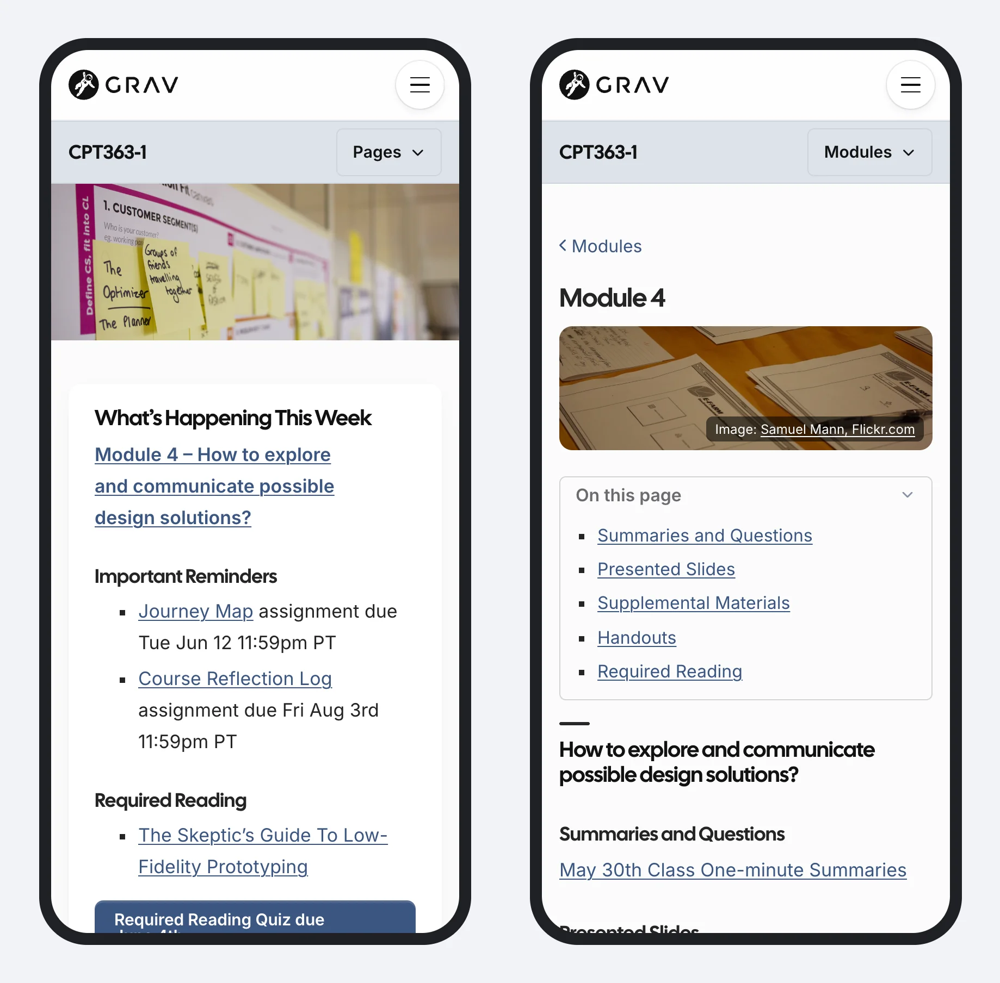

Its twin, for **courses**: a free, open-source course site organized by modules – one course or many, in a single site.

- A module list beside every module page, with Previous and Next
- Home page reminders that link to this week's and next week's modules
- On phones, a module's sections in an "On this page" box
- Each course with its own menu, colour and header image, and a blog shared by all your courses

Pages **embed in Canvas, Moodle or Brightspace** – just add `?embedded=true` (this works for Open Publishing Space pages too).

[showifembedded]
> [!TIP]
> You're reading this page embedded – the same way it would appear inside Canvas, Moodle or Brightspace.
[/showifembedded]

**New:** Open Course Space is an early release – the free successor to Open Course Hub and Open MultiCourse Hub, which are still available, including for Grav 1.7.

*A course home page, from the Open Course Space demo*

*The Open Course Space demo on a phone: this week's module on the home page, and a module's sections in an "On this page" box*

[hideifembedded]
[See the demo](https://demo.hibbittsdesign.org/grav-open-course-space/) · [A module, embedded](https://demo.hibbittsdesign.org/grav-open-course-space/cpt363-basic/modules/module-04?embedded=true) · [This page, embedded](/guide/modules/open-course-hub?embedded=true)

Try the Admin 2 panel with a course site: [read-only demo](https://try.hibbittsdesign.org/grav-skeleton-course-hub/admin) (the sign-in details are on its sign-in screen).
[/hideifembedded]

> [!NOTE]
> **You're using it now:** this course site is built with Open Course Space – the module list beside this page, and Previous and Next below it.
