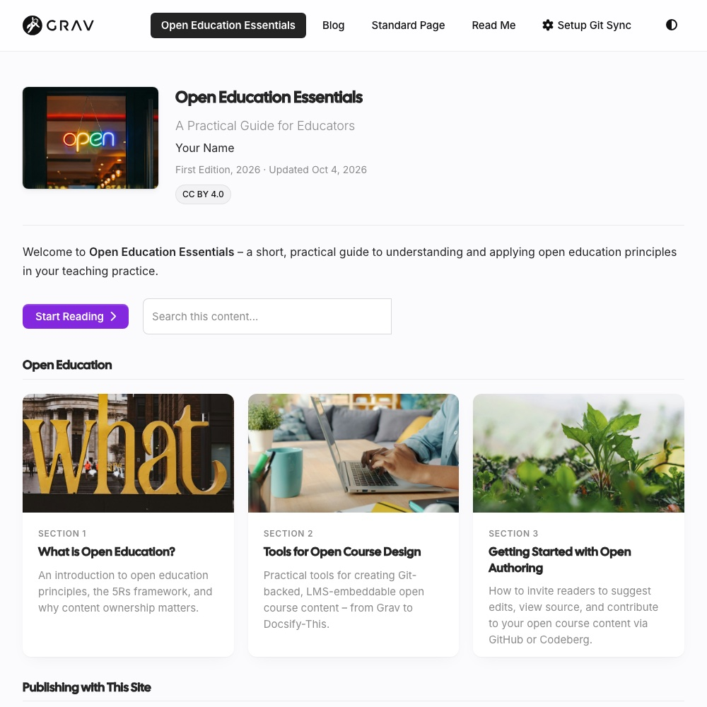

A free, open-source website starter for **open textbooks and guides**, with a blog alongside.

- Guides with section cards, reading progress and **Keep My Place** (come back to this guide's home page to continue where you left off, even partway down a page)
- Learning Objectives, OER attribution and search
- One site can hold several guides, each with a card on a Guides page, plus other pages – like this site's Topics and Resources
- On phones, the header slides out of the way while you read, and Previous/Next stay in a bar at the bottom of the screen (scroll this page on your phone to see both)

> [!TIP]
> **Get the Markdown behind any page:** add `.md` to its address – no access to the source files needed.

*A guide home page, from the Open Publishing Space demo*

*A page of this guide on a phone: the header slides away as you read, and Previous/Next stay at the bottom*

[hideifembedded]
See the demo: [one guide](https://demo.hibbittsdesign.org/grav-open-publishing-quark2/) · [several guides](https://demo.hibbittsdesign.org/grav-open-publishing-quark2-guides/)

Try the Admin 2 panel: [read-only demo](https://try.hibbittsdesign.org/grav-skeleton-open-publishing-space/admin) (the sign-in details are on its sign-in screen). Once signed in, the project's ReadMe is in the Admin sidebar, thanks to the [Admin2 Site ReadMe plugin](https://hibbittsdesign.org/cost-free-grav-projects.html#admin2-site-readme-plugin).
[/hideifembedded]
