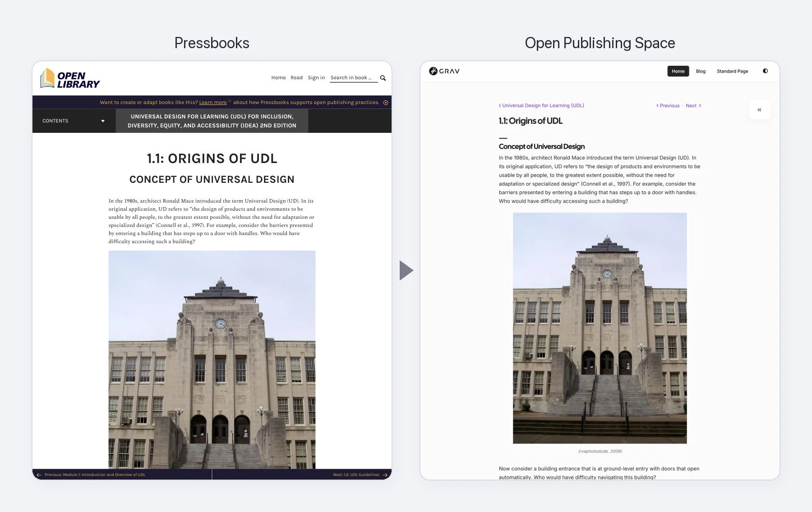

Start from what you already have, with two free converters (both in beta) – no Grav installation needed to see what carries over:

- **[Pressbooks Converter](https://pressbooks-converter.hibbittsdesign.org/)** – upload a Pressbooks export, and download an Open Publishing Space guide, ready to review and publish
- **[Common Cartridge Converter](https://common-cartridge-converter.hibbittsdesign.org/)** – export a course from Canvas, Moodle, Brightspace or Blackboard, and download its modules, ready for Open Course Hub

*The same chapter in Pressbooks and in Open Publishing Space, with no revisions – from [Universal Design for Learning (UDL) for Inclusion, Diversity, Equity, and Accessibility (IDEA)](https://ecampusontario.pressbooks.pub/universaldesign2/), CC BY 4.0*

Examples (raw conversions, with no revisions or fine-tuning): [an openly licensed Pressbooks book in Open Publishing Space](https://demo.hibbittsdesign.org/grav-open-publishing-quark2-pressbooks-udl/) · [an LMS course in Open Course Hub](https://demo.hibbittsdesign.org/grav-open-course-hub-common-cartridge-it2dda/)
