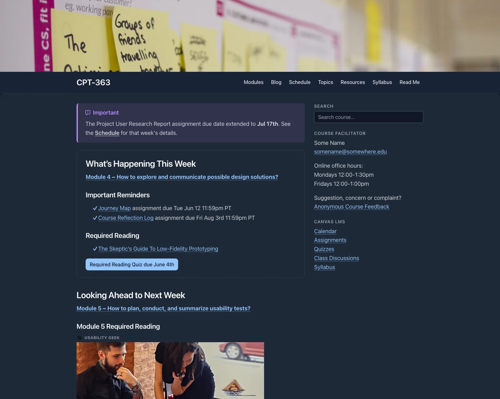

Built in, for different kinds of readers:

- **For keyboard users:** a "Skip to content" link, arrow-key Previous/Next on guide pages, **/** to jump to a guide's search box, and wide tables you can reach with Tab
- **For screen reader users:** one page title per page (kept even when hidden), labelled page regions and links, and titled embeds – a guide's side list can announce the section you're reading (with the Page TOC plugin), and Open Course Hub also announces the current section and open or closed accordions
- **For everyone:** comfortable line lengths and text size on guide pages, light and dark modes, and clean printed pages
- **For privacy:** content stays on a site you control, with no third-party tracking (Grav's own page view counts stay on the site too), and Keep My Place remembers a reader's place in their own browser only

*Open Course Hub in dark mode*

Accessibility also depends on the content itself – headings, alt text and link text are up to the author.
