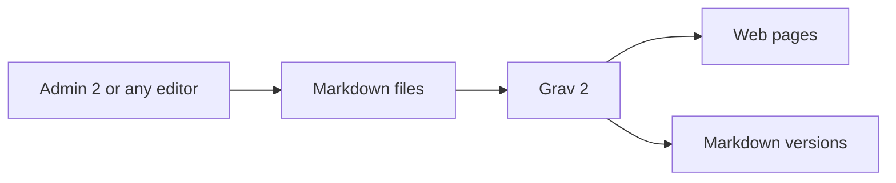
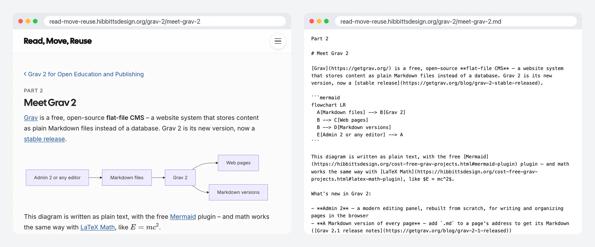

[Grav](https://getgrav.org/?target=_blank) is a free, open-source **flat-file CMS** – a website system that stores content as plain Markdown files instead of a database. Grav 2 is its new version, now a stable release.

This diagram is written as plain text, with the free [Mermaid](https://hibbittsdesign.org/cost-free-grav-projects.html?target=_blank#mermaid-plugin) plugin – and math works the same way with [LaTeX Math](https://hibbittsdesign.org/cost-free-grav-projects.html?target=_blank#latex-math-plugin), like $E = mc^2$.

What's new in Grav 2:

- **Admin 2** – a modern editing panel, rebuilt from scratch, for writing and organizing pages in the browser
- **A Markdown version of every page** – add `.md` to a page's address to get its Markdown
- **Faster under the hood, and still just files** – a site that's simple to back up, copy and move

*This page, and its Markdown version*

What Grav has always had:

- **Free and open source** (MIT license), with over 15,000 stars on [GitHub](https://github.com/getgrav/grav?target=_blank)
- **Themes and plugins** for search, feeds, forms, several languages and more
- **Runs on a standard web host** – no special server setup

**Coming from WordPress?** Much of it will feel familiar:

| In WordPress | In Grav 2 |
|---|---|
| Dashboard | Admin 2 |
| Pages and posts | Pages, each a Markdown file in its own folder – with a blog page for posts |
| Block editor | Markdown, with shortcodes for extras like callouts and embeds |
| Database | None – just files |
| A backup plugin | Copy the site's folder |

[hideifembedded]
Try the Admin 2 panel: read-only demos for [Open Publishing Space](https://try.hibbittsdesign.org/grav-skeleton-open-publishing-space/admin?target=_blank) and [Open Course Hub](https://try.hibbittsdesign.org/grav-skeleton-course-hub/admin?target=_blank) (the sign-in details are on their sign-in screens).

See this page [as Markdown](/grav-2/meet-grav-2.md?target=_blank), and compare the diagram with the text that draws it.
[/hideifembedded]
