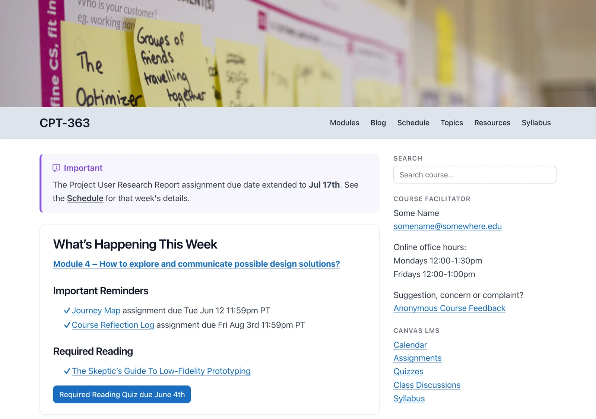

Its twin, for **courses**: a free, open-source course site organized by modules.

- A module list beside every module page, with Previous and Next
- Home page reminders that link to this week's and next week's modules
- An optional course blog

Pages **embed in Canvas, Moodle or Brightspace** – just add `?embedded=true` (this works for Open Publishing Space pages too).

Teaching several courses? Its sibling, **Open MultiCourse Hub 2**, gives each one its own course site, all in a single install.

*A course home page, from the Open Course Hub demo*

Already have a course in your LMS? Start from it, with a free converter (in beta) – no Grav installation needed to see what carries over:

- **[Common Cartridge Converter](https://common-cartridge-converter.hibbittsdesign.org/?target=_blank)** – export a course from Canvas, Moodle, Brightspace or Blackboard, and download its modules, ready for Open Course Hub

Example (a raw conversion, with no revisions or fine-tuning): [an LMS course in Open Course Hub](https://demo.hibbittsdesign.org/grav-open-course-hub-common-cartridge-it2dda/?target=_blank)

**Want to start using Markdown, without a web server?** [Docsify-This](https://docsify-this.net/?target=_blank) shows your Markdown files as web pages, with free hosting such as GitHub – and when you're ready for a full site, the [Open Publishing Course Hub Converter](https://open-publishing-course-hub-converter.hibbittsdesign.org/?target=_blank) makes them the base of an Open Course Hub site, and can move them back if needed – see [a course on Docsify-This](https://docsify-this.net/?basePath=https://raw.githubusercontent.com/paulhibbitts/docsify-this-open-course-hub-site/main&homepage=home.md&sidebar=true&loadSidebar=_sidebar.md&loadNavbar=_navbar.md&loadFooter=_footer.md&pagination=true&searchbox=true&name=CPT-363&target=_blank).

[hideifembedded]
See the demo: [Open Course Hub](https://demo.hibbittsdesign.org/grav-open-course-hub/?target=_blank) · [a module, embedded](https://demo.hibbittsdesign.org/grav-open-course-hub/modules/module-04?embedded=true&target=_blank) · [Open MultiCourse Hub](https://demo.hibbittsdesign.org/grav-open-multi-course-hub/?target=_blank)

Try the Admin 2 panel: [read-only demo](https://try.hibbittsdesign.org/grav-skeleton-course-hub/admin?target=_blank) (the sign-in details are on its sign-in screen). Once signed in, the project's ReadMe is in the Admin sidebar, thanks to the [Admin2 Site ReadMe plugin](https://hibbittsdesign.org/cost-free-grav-projects.html?target=_blank#admin2-site-readme-plugin).
[/hideifembedded]

For more, see the [Open Courses](/open-course-hub) guide.
