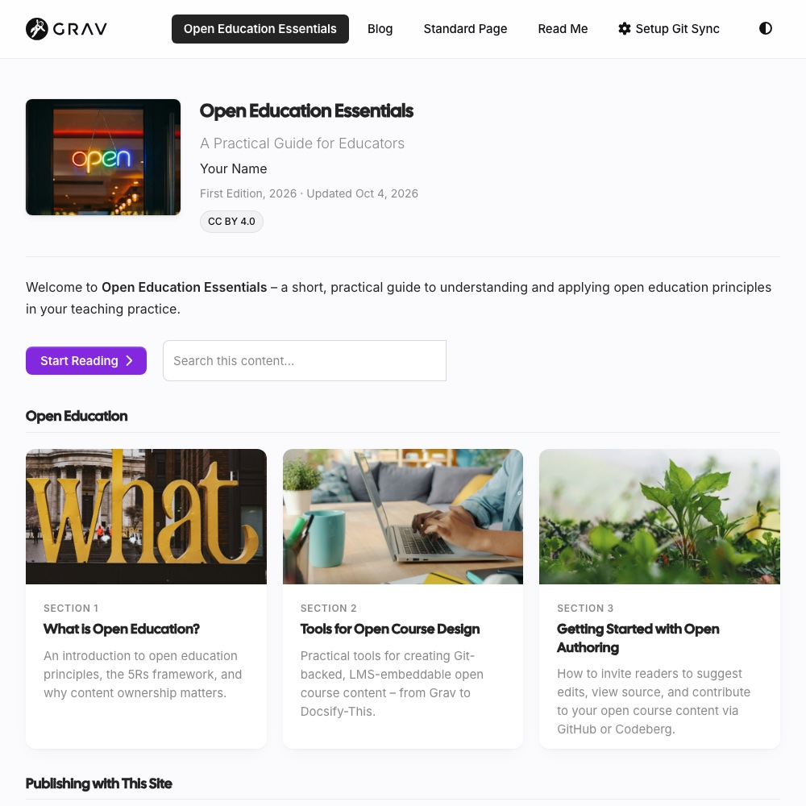
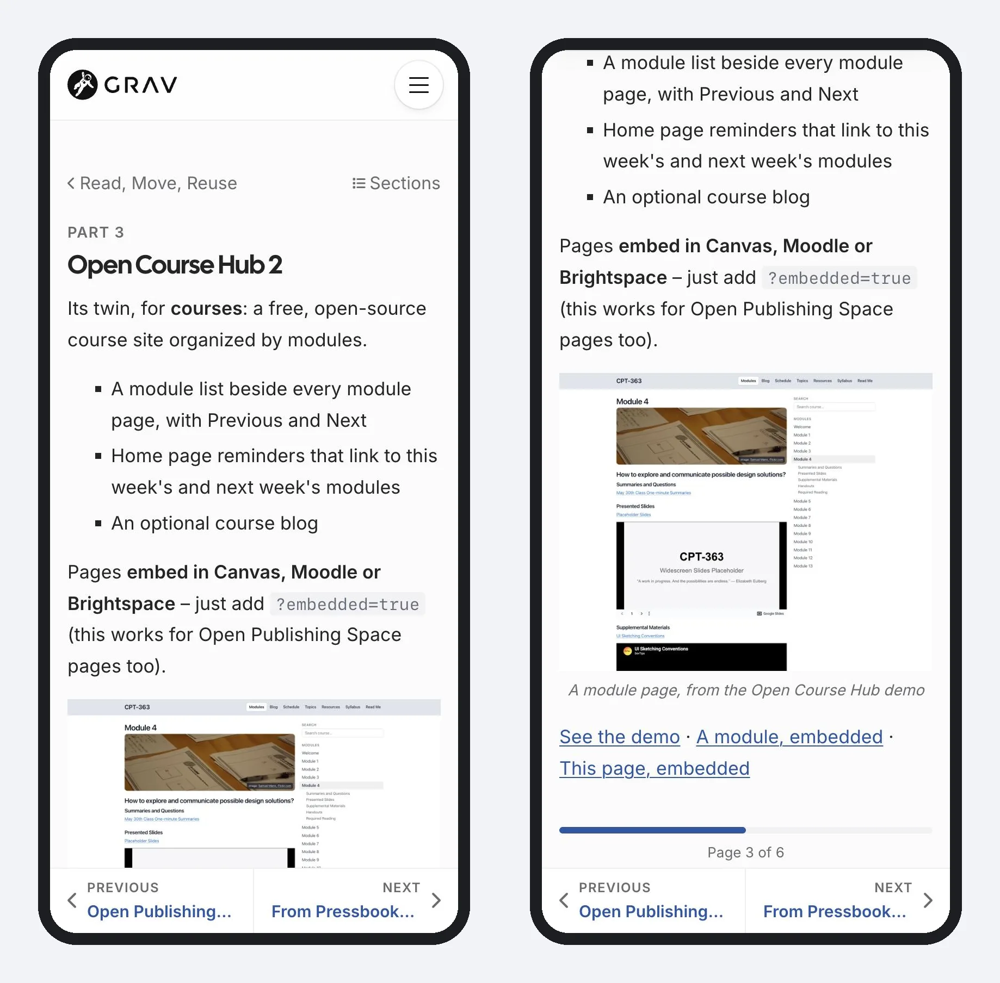

A free, open-source website starter for sharing **[term]web-first[/term] open textbooks and guides** alongside a blog and other pages, built on the [term]Grav[/term] 2 CMS. And being web-first, the website is each guide's main edition – easy to read on any device, with print and Markdown versions from the same pages.

- Guides with section cards, reading progress, Learning Objectives, [term]OER[/term] attribution, search and **Keep My Place** (pick up where you left off, even partway down a page)
- One site can hold several guides, each with a card on a Guides page and its own pages in the menu (like this guide's Topics and Resources) – plus site pages like [About](/about)
- Diagrams and math written as plain text, with the free [Mermaid](https://hibbittsdesign.org/cost-free-grav-projects.html#mermaid-plugin) and [LaTeX Math](https://hibbittsdesign.org/cost-free-grav-projects.html#latex-math-plugin) plugins – like $E = mc^2$, or this diagram:

Pages **embed in Canvas, Moodle or Brightspace** – just add `?embedded=true` to a page's address.

Editing works **in the browser** with Grav's Admin 2 panel, or as Markdown files with any editor or **via Git** – with no database needed, on most PHP web hosts.

[showifembedded]
> [!TIP]
> You're reading this page embedded – the same way it would appear inside Canvas, Moodle or Brightspace.
[/showifembedded]

*A guide home page, from the Open Publishing Space demo*

*A page of this guide on a phone: the header slides away as you read, and Previous/Next stay at the bottom*

[hideifembedded]
See the demo: [one guide](https://demo.hibbittsdesign.org/grav-open-publishing-quark2/) · [several guides](https://demo.hibbittsdesign.org/grav-open-publishing-quark2-guides/) · [This page, embedded](/open-publishing-space/open-publishing-space?embedded=true)

Try the Admin 2 panel: [read-only demo](https://try.hibbittsdesign.org/grav-skeleton-open-publishing-space/admin) (the sign-in details are on its sign-in screen).
[/hideifembedded]
