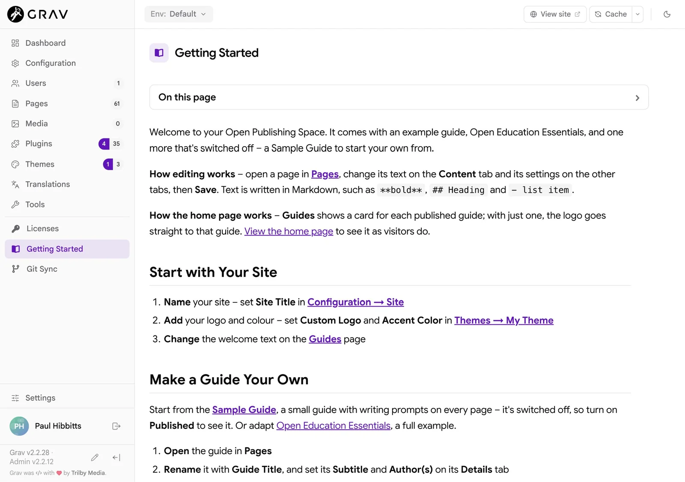

All the starters and converters in this guide are **free and open-source**, and you can explore the demo and try the converter with nothing to install:

- **"I want to share a textbook or guide"** → Open Publishing Space 2: demo with [one guide](https://demo.hibbittsdesign.org/grav-open-publishing-quark2/) or [several guides](https://demo.hibbittsdesign.org/grav-open-publishing-quark2-guides/) · [download](https://getgrav.org/downloads/skeletons#open-publishing-space-site)
- **"I already have a Pressbooks book"** → the [Pressbooks Converter](https://pressbooks-converter.hibbittsdesign.org/)
- **"I want to start using Markdown, with no web server"** → [Docsify-This](https://docsify-this.net/), then the [Open Publishing Course Hub Converter](https://open-publishing-course-hub-converter.hibbittsdesign.org/) when you're ready for a full site – see [these guides on Docsify-This](https://docsify-this.net/?basePath=https://raw.githubusercontent.com/paulhibbitts/docsify-this-open-publishing-space-site/main&homepage=home.md&sidebar=true&loadSidebar=_sidebar.md&loadNavbar=_navbar.md&collapsibleSidebarGroups=true&pagination=true&searchbox=true&name=Open%20Publishing%20Space%20Guides), or the [Docsify for Open Education and Publishing](/docsify) guide
- **"I teach a course"** → its twin, Open Course Space – see the [Open Courses](/open-course-hub) guide

[hideifembedded]

**Try it in 5 minutes:**

1. **Add** `.md` to this page's address to see its Markdown
2. **Press** ← and → to move through this guide, like slides
3. **Add** `?embedded=true` to this page's address to see it as it would appear in your LMS
4. **Sign in** to the [read-only Admin 2 demo](https://try.hibbittsdesign.org/grav-skeleton-open-publishing-space/admin?target=_blank) and open a page to see its Markdown

[/hideifembedded]

Then set up your own site:

1. **Download** a starter from [getgrav.org](https://getgrav.org/downloads/skeletons?target=_blank)
2. **Upload** it to your web host and unzip it (your host's file manager can do this), then open the site
3. **Open** Admin 2 by adding `/admin` to the site's address, set up your account, then follow **Getting Started** in its sidebar – the Sample Guide is ready to start your own from

*Getting Started in Admin 2, on a new Open Publishing Space site*

**Where to host:** many institutions offer web space for staff and students (often called a Domain of One's Own), and most low-cost web hosts run PHP 8.3 or newer.

**See it moved:** this same guide also runs, with the same content, on [the classic Quark theme](https://one.on-rev.com/grav/read-move-reuse-ops-quark/open-publishing-space?target=_blank), as an [Open Course Space course](https://demo.hibbittsdesign.org/read-move-reuse/read-move-reuse-ocs/open-publishing-space?target=_blank), and on Grav Premium Helios as an [open reader](https://one.on-rev.com/grav/read-move-reuse-hor/open-publishing-space?target=_blank) and a [course hub](https://one.on-rev.com/grav/read-move-reuse-hch/open-publishing-space?target=_blank) – and as plain Markdown pages on [Docsify-This](https://docsify-this.net/?basePath=https://raw.githubusercontent.com/paulhibbitts/docsify-this-read-move-reuse-site/main&homepage=home.md&name=Read%2C%20Move%2C%20Reuse&sidebar=true&loadSidebar=_sidebar.md&loadNavbar=_navbar.md&pagination=true&searchbox=true&dark-mode=auto&loadFavicon=favicon.png&target=_blank).

> [!IMPORTANT]
> **Good to know:** this web-first approach keeps things simple, but there's no built-in ebook generation (EPUB or formatted PDF – pages print cleanly from the browser), you'll need a [term]PHP[/term] web host (PHP 8.3 or newer, no database), and Grav extras like definition and objectives boxes are shortcodes that other tools would need converted.

With thanks to the authors of the openly licensed book used as an example, for sharing their work in the open 🙏🏻

**Share this guide:** [read-move-reuse.hibbittsdesign.org/open-publishing-space](https://read-move-reuse.hibbittsdesign.org/open-publishing-space) – licensed [CC BY 4.0](https://creativecommons.org/licenses/by/4.0/?target=_blank), so you can copy it, adapt it and share it, with credit.

Paul Hibbitts – [hibbittsdesign.org](https://hibbittsdesign.org/)
